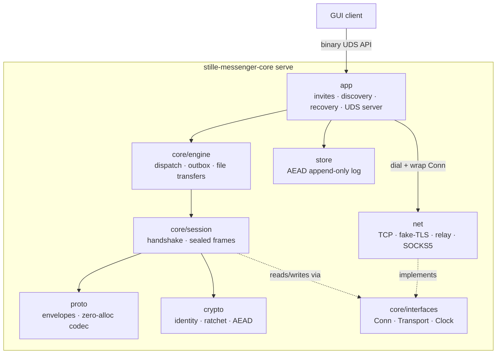

# Architecture (zig core)

Layer and data-flow reference for the `stille-messenger` core. Russian version:
[ru/ARCHITECTURE.md](ru/ARCHITECTURE.md).

## 1. Principles

1. **std-only**: zero external libraries. Cryptography is composition of
   `std.crypto` primitives — never a hand-rolled primitive.
2. **Boundaries via vtable interfaces** (`core/interfaces.zig`): `Conn`
   (readAll/writeAll/close), `Transport` (dial), `Clock` (time). Layers know
   only interfaces; concrete implementations are injected (dependency
   inversion). This is what makes the core testable without sockets.
3. **Zero allocations on the hot path**: frames and envelopes encode into
   caller-provided buffers (stack where possible). An allocator is required
   only by stateful structures (log index, session map).
4. **One concern per file.** A module imports only `core/interfaces.zig`,
   never a sibling module. Integration belongs to the engine layer.

## 2. Layers (top → bottom)

| Layer | Directory | Responsibility |
|---|---|---|
| app | `src/stille-messenger/app/` | daemon: UDS API server, invites, LAN discovery, autodial, outbox flushing, call audio loop, file transfers, configuration (config.zig), device sync (sync.zig), account recovery (recovery.zig: build/apply the sealed profile package; unprovisioned serve mode), Tor SOCKS5 dialing |
| core | `src/stille-messenger/core/` | engine (contacts, locks, dispatch, outbox, file Tx state machines), session (handshake + sealed frames) |
| proto | `src/stille-messenger/proto/` | binary envelopes, allocation-free codec |
| crypto | `src/stille-messenger/crypto/` | identity, hybrid handshake (X25519 + ML-KEM-768), ratchet, call keys, AEAD, padding |
| net | `src/stille-messenger/net/` | TCP transport, stream obfuscation (fake-TLS framing), relay, heartbeat, SOCKS5 (Tor) |
| store | `src/stille-messenger/store/` | encrypted append-only log |

Dependencies run one way (app → engine → session → proto/crypto →
interfaces); nothing reaches upward. The app layer is the only place that
dials: it creates a transport (TCP, fake-TLS, relay, SOCKS5), wraps the raw
connection into an obfuscated `interfaces.Conn` and hands it to the engine —
sessions never see a socket:



## 3. Message data flow

```
sendText
  → engine: outbox or live session
  → envelope.encode (stack buffer, formatting entities tail)
  → [optional zlib: payload ≥ 512 bytes → std.compress.flate]
  → [ratchet seal: 0xA1 | epoch | counter | comp | AEAD box]
  → session: writeAll of header+payload (one obf frame per envelope,
    batches for outbox flushes)
  → obfuscation: pad to size class + ChaCha20-Poly1305 frame box
  → fake-TLS record
  → TCP
```

Receive is the mirror: `Conn.readAll` → de-frame (AAD check, seq check) →
de-obfuscate → AEAD-open + optional inflate → envelope decode →
`Engine.dispatch` under the engine lock → callbacks into the app layer.

### 3.1 Persistence and device-sync data flow

```
persist* (app, under app.mu)
  → store.Log.append (encrypted log record: msg/contact/react/ack/
    file/block/cfg/client kinds)
  → sync.enqueue (if device_sync and a device link exists)
  → syncPumpLocked: takeBatch translates cid → bundle, appends per-record
    HMAC (HKDF(seed, "shopot-device-sync-v1")) into a stack tail buffer
  → SYNC envelope over the device session (like an outbox flush)
  → peer rx thread: parse records, verify MACs, apply idempotently
    (never re-enqueue), reply SYNC_ACK
  → onSyncAck / onSessionDown (queue restore, like outbox redelivery)
```

- The client DB (WRITE_DB records, kind `client`) shares the same path:
  an in-memory cache serves READ_DB; record MACs dedupe re-delivery.
- Configuration (kind `cfg`, last record wins) is applied on load and via
  SET_CONFIG; effects (server_mode presence threads, transport flags for
  new dials) are documented in CORE-API.md §4.9.

## 4. Threading model

- One **rx thread per session**; sending is serialized under the session
  mutex.
- The UDS API server accepts multiple clients; requests execute sequentially
  under the app lock; events fan out to all connections.
- Presence has no thread of its own: it is a pure state machine; time is
  injected via `Clock`, transport actions are returned to the caller.
- Relay presence runs its own loop: while a relay-backed contact is alive,
  unblocked and has no live session, it keeps the relay slot registered
  with the contact-level marker; pairing hands a fresh session to the
  engine. Start points: relay-invite JOIN, contact-log load, unblock.
- Call audio runs its own loop (FIFO in/out, 20 ms tick).
- Device sync piggybacks on session rx threads (no thread of its own);
  queue flushes happen under the app lock at enqueue time, on session
  bind, and after SET_CONFIG — the same lock ordering as outbox flushes
  (app.mu → session send mutex, never the reverse).
- Server-mode presence threads (one per contact when `server_mode` is on)
  re-read the configuration each iteration; turning the mode off stops
  them at the next cycle without teardown signalling.
- NAT-punch workers (2.9.0, one per contact, deduplicated in
  `punch_runs`) start when a relay-backed session receives the peer's
  PUNCH_CANDIDATES. A worker snapshots the route under the app lock, then
  works lock-free: host-candidate dials (initiator side only) and the
  simultaneous open from the same local address as the relay connection
  (`net/punch.zig`; budgets documented in PROTOCOL.md §15.1). A successful
  punched/LAN connection goes through the regular
  `establishSessionOnConn`/`handleAcceptedConn` paths — the new session
  retires the relay session in `bindSessionLocked`; a failure just sleeps
  and retries while the route is still the live session. No relay
  downgrade is possible: the punched path is adopted only after a full
  handshake.
- Invite connection scheduling is bounded and asynchronous: `connq_mu` is a
  leaf lock held only while queue metadata is changed, with at most 64 queued
  jobs and 4 active dial workers. One in-flight job is allowed per contact.
  Direct-to-relay fallback is permitted only during transport dial, never
  after handshake or JOIN authentication begins. Unknown incoming invite
  sessions are capped at 16 and have a 3-second pending-JOIN deadline.
- LAN discovery is one event-driven loop: a single UDP socket (multicast
  group 239.77.77.77 + limited broadcast, bound to INADDR_ANY) is polled
  together with a wake pipe, so peer announcements are heard the moment
  they are sent (no listen windows, no blind sleeps). The loop announces
  on a cadence — 500 ms base, 100 ms while an outbox entry or JOIN is
  pending — and immediately on API events (a send to an offline peer, a
  session drop). Hearing a peer triggers a unicast reply announcement
  (the peer learns about us within one RTT) and enqueues a dial job into
  the scheduler; the discovery loop itself never blocks on TCP, and every
  direct dial carries a 3-second deadline so a dead address cannot stall
  a worker.

## 5. Error and memory model

- Every module defines its own error set. `anyerror` appears only at
  interface boundaries; `catch unreachable` only in tests.
- Every public function takes `std.mem.Allocator` where allocation is needed.
  Hot paths use stack buffers or `FixedBufferAllocator`.
- No global state. Secrets (keys, chains, seeds) are wiped with
  `std.crypto.secureZero` when their owning object dies.

## 6. Callbacks (engine → app)

The engine reports everything through function pointers set by the app:
`onText`, `onReact`, `onAck`, presence changes, `onProfile`, `onAvatar`,
`onAvatarReq`, `onFileSent`, call state, `onSync`/`onSyncAck` (device-sync
batches). The app layer turns them into UDS events and DB writes.

## 7. Testing

- Unit tests (`test {}` blocks) live in each file and are owned by the
  module owner.
- Integration scenarios live in `tests/integration.zig`: full protocol
  between two in-process parties over loopback/scripted connections
  (handshake → messages → rotation → reconnect → resume).
- `zig build test` green is the handoff condition; CI runs it on every
  `zig-v*` tag together with release builds for x86_64-linux-musl and
  aarch64-macos.
