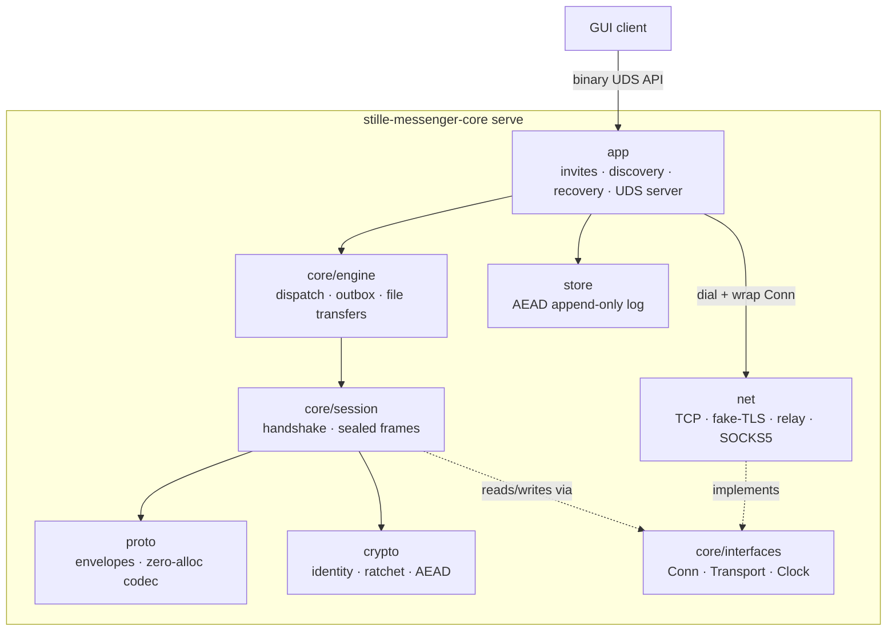

# Architecture (zig core)

Layer and data-flow reference for the `stille-messenger` core. Russian version:
[ru/ARCHITECTURE.md](ru/ARCHITECTURE.md).

## 1. Principles

1. **std-only**: zero external libraries. Cryptography is composition of
   `std.crypto` primitives — never a hand-rolled primitive.
2. **Boundaries via vtable interfaces** (`core/interfaces.zig`): `Conn`
   (readAll/writeAll/close), `Transport` (dial), `Clock` (time). Layers know
   only interfaces; concrete implementations are injected (dependency
   inversion). This is what makes the core testable without sockets.
3. **Zero allocations on the hot path**: frames and envelopes encode into
   caller-provided buffers (stack where possible). An allocator is required
   only by stateful structures (log index, session map).
4. **One concern per file.** A module imports only `core/interfaces.zig`,
   never a sibling module. Integration belongs to the engine layer.

## 2. Layers (top → bottom)

| Layer | Directory | Responsibility |
|---|---|---|
| app | `src/stille-messenger/app/` | daemon: UDS API server, invites, LAN discovery, outbox flushing, call audio loop, file transfers, configuration (config.zig), device sync (sync.zig), account recovery (recovery.zig: build/apply the sealed profile package; unprovisioned serve mode), Tor SOCKS5 dialing — decomposed into single-concern modules (§2.1) |
| core | `src/stille-messenger/core/` | engine (contacts, locks, dispatch, outbox, file Tx state machines), session (handshake + sealed frames) |
| proto | `src/stille-messenger/proto/` | binary envelopes, allocation-free codec |
| crypto | `src/stille-messenger/crypto/` | identity, hybrid handshake (X25519 + ML-KEM-768), ratchet, call keys, AEAD, padding |
| net | `src/stille-messenger/net/` | TCP transport, stream obfuscation (fake-TLS framing), relay, heartbeat, SOCKS5 (Tor) |
| store | `src/stille-messenger/store/` | encrypted append-only log |

Dependencies run one way (app → engine → session → proto/crypto →
interfaces); nothing reaches upward.

### 2.1 App-layer module map

The daemon is decomposed into single-concern modules. The dependency
direction is one-way at the LAYER level: nothing imports `main.zig`,
`app.zig` (state, types, limits) is a state sink every module imports,
and nothing reaches below its own layer. Sibling modules within the app
layer may import each other (e.g. connq ↔ dial) — local, single-layer
collaborations that Zig resolves; the inversions below removed the
cycles that used to pass through the monolith's root:

| module | responsibility |
|---|---|
| `main.zig` | composition root: CLI (init/relay/serve), `App` assembly, hook wiring, `api_srv.start` Deps, networking bootstrap, teardown |
| `app.zig` | `App` struct: all daemon state (contacts, sessions, invites, punch routes, call, config), shared types (`SessCtx`, `ConnWork`, `InviteReg`…), limits, `lock/unlock/nowMs` |
| `paths.zig` | data-dir migration, persistent seed (0600), hex utils |
| `events.zig` | ev* fanout to UDS clients, observable contact state, delta ring |
| `connq.zig` | connection scheduler: bounded queue, single-flight, workers (`connWorker`, `punchRun`) |
| `dial.zig` | deadline dial, fake-TLS wrap, handshake (both roles), JOIN window, accept loops |
| `routes.zig` | direct-path state: PUNCH_CANDIDATES/V6_ADDR exchange, reflexive addresses, ROUTE_STATE events |
| `receive.zig` | envelope dispatcher (`envIn`), JOIN/invite acceptance, engine callbacks (`on*Ev`), `bindSession` |
| `sync_apply.zig` | device-sync record apply (MAC check, idempotent), ACK |
| `persist.zig` | log record layouts, history/pins cache, sync enqueue/flush, full replay |
| `calls.zig` | call state machine, mic/jitter loops, call API |
| `presence.zig` | ticker, relay presence loops, server-mode presence, `applyConfigLocked` |
| `lan.zig` | LAN linker loop: announce, peer/device announcements |
| `invites.zig` | invite registry, accept flows, profile-code epoch, short codes, relay linkers |
| `profile_code.zig` | profile-code secret/invite-id derivation (domain-separated) |
| `api_handlers.zig` | UDS method handlers (messaging/history/contacts/system) |
| `dispatch.zig` | `ApiRequest` → handler → exactly one response |
| `api_server.zig` | UDS transport: framing, conn set, fanout — knows nothing of `App` (deps injected via `Deps`) |
| leaf helpers | `invite.zig`, `endpoints.zig`, `discover.zig`, `wake.zig`, `audio.zig`, `adpcm.zig`, `search.zig`, `sync.zig`, `config.zig` |

Two dependency inversions removed the former cycles through the
composition root (same idiom as `sync.tr_fn`):

- `App.session_bind / session_env_in / session_on_closed` — function
  pointers set once in `main()` before threads start: `dial.zig` binds
  sessions and feeds envelopes without importing the receive layer.
- `api_srv.Deps` — the UDS server receives the app context, dispatch
  function and lock/unlock as injected pointers; it imports no app-layer
  module.

`persist.zig` owns sync enqueue/flush, `sync_apply.zig` owns record
application — the split is what keeps `persist → sync_apply` one-way. The app layer is the only place that
dials: it creates a transport (TCP, fake-TLS, relay, SOCKS5), wraps the raw
connection into an obfuscated `interfaces.Conn` and hands it to the engine —
sessions never see a socket:



## 3. Message data flow

```
sendText
  → engine: outbox or live session
  → envelope.encode (stack buffer, formatting entities tail)
  → [optional zlib: payload ≥ 512 bytes → std.compress.flate]
  → [ratchet seal: 0xA1 | epoch | counter | comp | AEAD box]
  → session: writeAll of header+payload (one obf frame per envelope,
    batches for outbox flushes)
  → obfuscation: pad to size class + ChaCha20-Poly1305 frame box
  → fake-TLS record
  → TCP
```

Receive is the mirror: `Conn.readAll` → de-frame (AAD check, seq check) →
de-obfuscate → AEAD-open + optional inflate → envelope decode →
`Engine.dispatch` under the engine lock → callbacks into the app layer.

### 3.1 Persistence and device-sync data flow

```
persist* (app, under app.mu)
  → store.Log.append (encrypted log record: msg/contact/react/ack/
    file/block/cfg/client kinds)
  → sync.enqueue (if device_sync and a device link exists)
  → syncPumpLocked: takeBatch translates cid → bundle, appends per-record
    HMAC (HKDF(seed, "shopot-device-sync-v1")) into a stack tail buffer
  → SYNC envelope over the device session (like an outbox flush)
  → peer rx thread: parse records, verify MACs, apply idempotently
    (never re-enqueue), reply SYNC_ACK
  → onSyncAck / onSessionDown (queue restore, like outbox redelivery)
```

- The client DB (WRITE_DB records, kind `client`) shares the same path:
  an in-memory cache serves READ_DB; record MACs dedupe re-delivery.
- Configuration (kind `cfg`, last record wins) is applied on load and via
  SET_CONFIG; effects (server_mode presence threads, transport flags for
  new dials) are documented in CORE-API.md §4.9.

## 4. Threading model

- One **rx thread per session**; sending is serialized under the session
  mutex.
- The UDS API server accepts multiple clients; requests execute sequentially
  under the app lock; events fan out to all connections.
- Presence has no thread of its own: it is a pure state machine; time is
  injected via `Clock`, transport actions are returned to the caller.
- Relay presence runs its own loop: while a relay-backed contact is alive,
  unblocked and has no live session, it keeps the relay slot registered
  with the contact-level marker; pairing hands a fresh session to the
  engine. Start points: relay-invite JOIN, contact-log load, unblock.
- Call audio runs its own loop (FIFO in/out, 20 ms tick).
- Device sync piggybacks on session rx threads (no thread of its own);
  queue flushes happen under the app lock at enqueue time, on session
  bind, and after SET_CONFIG — the same lock ordering as outbox flushes
  (app.mu → session send mutex, never the reverse).
- Server-mode presence threads (one per contact when `server_mode` is on)
  re-read the configuration each iteration; turning the mode off stops
  them at the next cycle without teardown signalling.
- Direct-first (2.10.0): a second accept loop serves the IPv6 listener
  (`[::]:listen_port`, V6ONLY, separate fd — the v4 path is untouched),
  and a one-shot UPnP thread (startup, gated on `autodial`) performs
  SSDP discovery + AddPortMapping with 1.5/3 s deadlines; the public
  endpoint lands in `app.upnp_ext` under the app lock. Address learning
  (V6_ADDR frames, getpeername on incoming direct conns) happens on
  session rx threads / the accept path; autodial's fast-presence
  ceiling (3 s) is a pure parameter of its backoff.
- NAT-punch workers (2.9.0, one per contact, deduplicated in
  `punch_runs`) start when a relay-backed session receives the peer's
  PUNCH_CANDIDATES. A worker snapshots the route under the app lock, then
  works lock-free: host-candidate dials (initiator side only) and the
  simultaneous open from the same local address as the relay connection
  (`net/punch.zig`; budgets documented in PROTOCOL.md §15.1). A successful
  punched/LAN connection goes through the regular
  `establishSessionOnConn`/`handleAcceptedConn` paths — the new session
  retires the relay session in `bindSessionLocked`; a failure just sleeps
  and retries while the route is still the live session. No relay
  downgrade is possible: the punched path is adopted only after a full
  handshake.
- Invite connection scheduling is bounded and asynchronous: `connq_mu` is a
  leaf lock held only while queue metadata is changed, with at most 64 queued
  jobs and 4 active dial workers. One in-flight job is allowed per contact.
  Direct-to-relay fallback is permitted only during transport dial, never
  after handshake or JOIN authentication begins. Unknown incoming invite
  sessions are capped at 16 and have a 3-second pending-JOIN deadline.
- LAN discovery is one event-driven loop: a single UDP socket (multicast
  group 239.77.77.77 + limited broadcast, bound to INADDR_ANY) is polled
  together with a wake pipe, so peer announcements are heard the moment
  they are sent (no listen windows, no blind sleeps). The loop announces
  on a cadence — 500 ms base, 100 ms while an outbox entry or JOIN is
  pending — and immediately on API events (a send to an offline peer, a
  session drop). Hearing a peer triggers a unicast reply announcement
  (the peer learns about us within one RTT) and enqueues a dial job into
  the scheduler; the discovery loop itself never blocks on TCP, and every
  direct dial carries a 3-second deadline so a dead address cannot stall
  a worker.

## 5. Error and memory model

- Every module defines its own error set. `anyerror` appears only at
  interface boundaries; `catch unreachable` only in tests.
- Every public function takes `std.mem.Allocator` where allocation is needed.
  Hot paths use stack buffers or `FixedBufferAllocator`.
- No global state. Secrets (keys, chains, seeds) are wiped with
  `std.crypto.secureZero` when their owning object dies.

## 6. Callbacks (engine → app)

The engine reports everything through function pointers set by the app
(`receive.engineEvents` in the daemon; the app→receive direction is
inverted through `App.session_bind` and friends, §2.1):
`onText`, `onReact`, `onAck`, presence changes, `onProfile`, `onAvatar`,
`onAvatarReq`, `onFileSent`, call state, `onSync`/`onSyncAck` (device-sync
batches). The app layer turns them into UDS events and DB writes.

## 7. Testing

Test **roots and test bodies live in `tests/`**, never in `src/` (Zig
compiles `test` blocks only under test roots, so roots are explicit):

| step | root | what runs |
|---|---|---|
| `zig build test-unit` | `src/stille-messenger.zig` (test-mode library module) | co-located invariant tests of library files, collected by the root's explicit import block |
| `zig build test-proto` | `tests/proto.zig` | protocol conformance bodies in `tests/proto/` |
| `zig build test-crypto` | `tests/crypto.zig` | crypto conformance bodies in `tests/crypto/` |
| `zig build test-app` | `src/stille-messenger/app/main.zig` + `tests/app.zig` | co-located tests of app-tree files + daemon test bodies in `tests/app.zig` (import the app tree via the `app-main` module) |
| `zig build test-integration` | `tests/integration.zig` | end-to-end scenarios over loopback/scripted connections (handshake → messages → rotation → reconnect → resume) |
| `zig build test` | — | all of the above; `zig build bench` runs the transport benchmark (`tests/bench_transport.zig`) |

Co-location policy: a file keeps its `test` blocks in `src/` only when
they exercise **private** declarations (e.g. `core/session.zig`,
`core/engine.zig`, `store/log.zig`, most `net/` files); the library
root and `main.zig` also keep pure aggregation blocks
(`test { _ = @import(…) }`). Everything else — bodies with public-API
access only — moves to `tests/`. `tests/README.md` documents the policy.

`zig build test` green is the handoff condition; CI runs it on every
`zig-v*` tag together with release builds for x86_64-linux-musl and
aarch64-macos.
