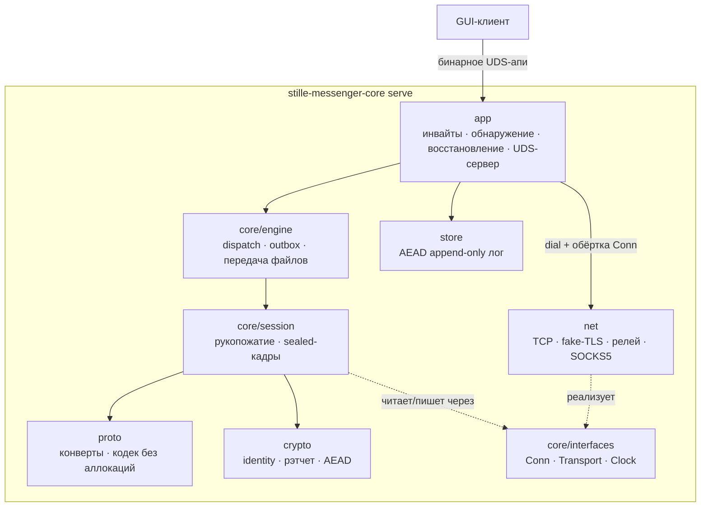

# Архитектура (ядро zig)

Справочник слоёв и потоков данных ядра `stille-messenger`. Английская версия:
[../ARCHITECTURE.md](../ARCHITECTURE.md).

## 1. Принципы

1. **std-only**: ноль внешних библиотек. Криптография — композиция примитивов
   `std.crypto`, самодельные примитивы запрещены.
2. **Границы через vtable-интерфейсы** (`core/interfaces.zig`): `Conn`
   (readAll/writeAll/close), `Transport` (dial), `Clock` (время). Слои знают
   только интерфейсы, конкретика инжектируется (dependency inversion).
   Именно это делает ядро тестируемым без сокетов.
3. **Ноль аллокаций на горячем пути**: кадры и конверты кодируются в буферы
   вызывающего (стек, где возможно). Аллокатор нужен только структурам с
   временем жизни (индекс лога, карта сессий).
4. **Один смысл — один файл.** Модуль импортирует только
   `core/interfaces.zig`, не соседей. Интеграция — слой движка.

## 2. Слои (сверху вниз)

| Слой | Каталог | Ответственность |
|---|---|---|
| app | `src/stille-messenger/app/` | демон: UDS-апи-сервер, инвайты, LAN-поиск, автодозвон, выгрузка outbox, аудиоконтур звонка, передача файлов, конфигурация (config.zig), синхронизация устройств (sync.zig), восстановление доступа (recovery.zig: сборка/применение запечатанного пакета профиля; непровижненный режим serve), dial через Tor SOCKS5 |
| core | `src/stille-messenger/core/` | engine (контакты, блокировки, dispatch, outbox, стейт-машины file Tx), session (рукопожатие + sealed-кадры) |
| proto | `src/stille-messenger/proto/` | бинарные конверты, кодек без аллокаций |
| crypto | `src/stille-messenger/crypto/` | identity, гибридное рукопожатие (X25519 + ML-KEM-768), рэтчет, ключи звонка, AEAD, паддинг |
| net | `src/stille-messenger/net/` | TCP-транспорт, обфускация потока (fake-TLS кадрирование), релей, heartbeat, SOCKS5 (Tor) |
| store | `src/stille-messenger/store/` | шифрованный append-only лог |

### 2.1 Карта модулей app-слоя

Демон разложен на модули с одной ответственностью. Направление
зависимостей однонаправленно на уровне СЛОЁВ: `main.zig` никто не
импортирует, `app.zig` (состояние, типы, лимиты) — сток состояния,
который импортируют все, вниз за пределы своего слоя никто не тянется.
Модули-соседи внутри app-слоя могут импортировать друг друга (напр.
connq ↔ dial) — это локальные взаимодействия одного слоя, Zig их
разрешает; инверсии ниже убрали циклы, которые раньше проходили через
корень монолита:

| модуль | ответственность |
|---|---|
| `main.zig` | корень композиции: CLI (init/relay/serve), сборка `App`, подключение хуков, `api_srv.start` (Deps), подъём сети, teardown |
| `app.zig` | структура `App`: всё состояние демона (контакты, сессии, инвайты, punch-маршруты, звонок, конфиг), общие типы (`SessCtx`, `ConnWork`, `InviteReg`…), лимиты, `lock/unlock/nowMs` |
| `paths.zig` | миграция каталога данных, персистентный сид (0600), hex-утилиты |
| `events.zig` | рассылка ev* клиентам UDS-апи, наблюдаемое состояние контактов, кольцо дельты |
| `connq.zig` | планировщик подключений: ограниченная очередь, single-flight, воркеры (`connWorker`, `punchRun`) |
| `dial.zig` | dial с дедлайном, обёртка fake-TLS, handshake (обе роли), окно JOIN, accept-циклы |
| `routes.zig` | состояние прямого пути: обмен PUNCH_CANDIDATES/V6_ADDR, рефлексивные адреса, ROUTE_STATE |
| `receive.zig` | диспетчер конвертов (`envIn`), приём JOIN/инвайтов, колбэки движка (`on*Ev`), `bindSession` |
| `sync_apply.zig` | применение записей device-sync (MAC, идемпотентность), ACK |
| `persist.zig` | форматы записей лога, кэш истории/закреплений, постановка в sync-очередь и флаш, полный replay |
| `calls.zig` | state machine звонка, циклы mic/jitter, апи звонков |
| `presence.zig` | тикер, relay-присутствие, server-mode-присутствие, `applyConfigLocked` |
| `lan.zig` | цикл LAN-линкера: анонсы, обработка анонсов пиров/устройств |
| `invites.zig` | реестр инвайтов, потоки принятия, эпоха профиль-кода, короткие коды, relay-линкеры |
| `profile_code.zig` | вывод секрета/идентификатора профиль-кода (домен отделён) |
| `api_handlers.zig` | обработчики методов UDS-апи (сообщения/история/контакты/система) |
| `dispatch.zig` | `ApiRequest` → обработчик → ровно один ответ |
| `api_server.zig` | транспорт UDS: кадры, множество коннов, fanout — не знает про `App` (зависимости инжектируются через `Deps`) |
| вспомогательные | `invite.zig`, `endpoints.zig`, `discover.zig`, `wake.zig`, `audio.zig`, `adpcm.zig`, `search.zig`, `sync.zig`, `config.zig` |

Две инверсии зависимостей (идиома как у `sync.tr_fn`):

- `App.session_bind / session_env_in / session_on_closed` — указатели на
  функции, заполняются один раз в `main()` до старта потоков: `dial.zig`
  привязывает сессии и доставляет конверты, не импортируя слой приёма.
- `api_srv.Deps` — UDS-сервер получает контекст приложения, диспетчер и
  lock/unlock инжектированными указателями; модули app-слоя он не импортирует.

Постановку в sync-очередь и флаш владеет `persist.zig`, применение записей —
`sync_apply.zig`: разделение держит `persist → sync_apply` однонаправленным.

Зависимости однонаправленные (app → engine → session → proto/crypto →
interfaces), вверх никто не тянет. Диалит только слой app: он создаёт
транспорт (TCP, fake-TLS, релей, SOCKS5), оборачивает сырое соединение в
обфусцированный `interfaces.Conn` и передаёт его движку — сессия сокета
не видит вообще:



## 3. Поток данных сообщения

```
sendText
  → движок: outbox или живая сессия
  → envelope.encode (буфер на стеке, хвост entities форматирования)
  → [опционально zlib: payload ≥ 512 байт → std.compress.flate]
  → [запечатывание рэтчетом: 0xA1 | epoch | counter | comp | AEAD-бокс]
  → сессия: writeAll заголовка+payload (один obf-кадр на конверт,
    пачки для выгрузки outbox)
  → обфускация: паддинг до класса размера + ChaCha20-Poly1305-бокс кадра
  → fake-TLS запись
  → TCP
```

Приём — зеркало: `Conn.readAll` → разбор кадра (проверка AAD и seq) →
деобфускация → AEAD-open + опциональный inflate → декод конверта →
`Engine.dispatch` под блокировкой движка → колбэки в слой приложения.

### 3.1. Поток данных хранения и синхронизации устройств

```
persist* (app, под app.mu)
  → store.Log.append (шифрованная запись лога: kind msg/contact/react/
    ack/file/block/cfg/client)
  → sync.enqueue (если device_sync и есть линк устройства)
  → syncPumpLocked: takeBatch переводит cid → bundle, добавляет на запись
    HMAC (HKDF(seed, "shopot-device-sync-v1")), собирает хвост в стеке
  → конверт SYNC по сессии устройства (как выгрузка outbox)
  → rx-поток пира: разбор записей, проверка MAC, идемпотентное применение
    (без обратной постановки в очередь), ответ SYNC_ACK
  → onSyncAck / onSessionDown (возврат партий в очередь, как у outbox)
```

- Клиентская БД (записи WRITE_DB, kind `client`) идёт тем же путём: кэш
  в памяти обслуживает READ_DB, MAC-и записей дедупят повторную доставку.
- Конфигурация (kind `cfg`, побеждает последняя запись) применяется при
  загрузке и через SET_CONFIG; эффекты (потоки присутствия server_mode,
  транспортные флаги для новых dial-ов) — в CORE-API.md §4.9.

## 4. Потоки

- Один **rx-поток на сессию**; отправка сериализуется мьютексом сессии.
- UDS-апи-сервер принимает несколько клиентов; запросы исполняются
  последовательно под блокировкой приложения; события рассылаются всем.
- Presence не имеет своего потока: чистая машина состояний, время
  инжектируется через `Clock`, транспортные действия возвращаются
  вызывающему.
- Релей-присутствие — свой цикл: пока relay-контакт жив, не заблокирован
  и без живой сессии, держит слот релея контакт-маркером; спаривание
  отдаёт движку новую сессию. Старты: relay-инвайт JOIN, загрузка лога
  контактов, разблокировка.
- Аудио звонка — свой цикл (fifo ввод/вывод, тик 20 мс).
- Синхронизация устройств живёт на rx-потоках сессий (своего потока нет);
  выгрузка очередей — под блокировкой приложения: при постановке, при
  бинде сессии и после SET_CONFIG — тот же порядок локов, что у outbox
  (app.mu → send-мьютекс сессии, обратного пути нет).
- Потоки присутствия своего сервера (по одному на контакт при включённом
  `server_mode`) перечитывают конфигурацию каждую итерацию: выключение
  режима останавливает их на следующем цикле, без сигнального teardown.
- Direct-first (2.10.0): второй accept-цикл обслуживает IPv6-листенер
  (`[::]:listen_port`, V6ONLY, отдельный fd — v4-путь не тронут), и
  однопроходный UPnP-поток (старт, под флагом `autodial`) делает
  SSDP-поиск + AddPortMapping с дедлайнами 1.5/3 с; публичный endpoint
  попадает в `app.upnp_ext` под локом приложения. Изучение адресов
  (кадры V6_ADDR, getpeername входящих прямых коннов) идёт в rx-потоках
  сессий / на accept-пути; потолок fast-presence автодозвона (3 с) —
  чистый параметр его бэкоффа.
- Punch-воркеры NAT-обхода (2.9.0, по одному на контакт, дедуп в
  `punch_runs`) стартуют, когда relay-сессия получила PUNCH_CANDIDATES
  пира. Воркер снимает маршрут под локом приложения, дальше работает без
  лока: dial по host-кандидатам (только сторона-инициатор) и
  одновременный open из того же локального адреса, что relay-подключение
  (`net/punch.zig`; бюджеты — PROTOCOL.md §15.1). Успешный пробитый/LAN-
  конн идёт штатными путями `establishSessionOnConn`/`handleAcceptedConn`
  — новая сессия замещает relay-сессию в `bindSessionLocked`; неудача
  просто спит и повторяет, пока маршрут — живая сессия. Даунгрейда на
  релей нет: пробитый путь принимается только после полного рукопожатия.
- Планировщик подключений инвайтов ограничен и асинхронен: листовой лок
  `connq_mu` защищает только метаданные очереди, максимум 64 ожидающие работы
  и 4 активных dial-потока; на контакт допускается одна работа одновременно.
  Переход с direct на relay разрешён только при сетевом сбое dial, но не после
  начала рукопожатия/JOIN. Неизвестных входящих pending-сессий — максимум 16,
  дедлайн ожидания JOIN — 3 секунды.
- LAN-обнаружение — один событийный цикл: единственный UDP-сокет (группа
  мультикаста 239.77.77.77 + limited broadcast, бинд на INADDR_ANY)
  опрашивается poll-ом вместе с pipe-будилкой, поэтому анонс пира слышится
  в момент отправки (никаких «окон слушания» и слепых снов). Анонсы идут
  по каденсу — 500 мс базово, 100 мс пока есть pending outbox/JOIN — и
  немедленно по событиям API (отправка офлайн-пиру, разрыв сессии). Услышав
  пира, цикл отвечает unicast-анонсом (пир узнаёт о нас за один RTT) и
  ставит работу dial в планировщик; сам цикл обнаружения никогда не
  блокируется на TCP, а каждый прямой dial несёт дедлайн 3 секунды —
  мёртвый адрес не подвешивает поток.

## 5. Модель ошибок и памяти

- Каждый модуль определяет свой error set. `anyerror` — только на границах
  интерфейсов; `catch unreachable` — только в тестах.
- Каждая публичная функция принимает `std.mem.Allocator`, если аллокация
  нужна. Горячие пути — стек или `FixedBufferAllocator`.
- Глобального состояния нет. Секреты (ключи, цепочки, сиды) обнуляются
  `std.crypto.secureZero` при смерти владеющего объекта.

## 6. Колбэки (движок → приложение)

Движок отчитывается функциональными указателями, которые ставит приложение:
`onText`, `onReact`, `onAck`, изменения presence, `onProfile`, `onAvatar`,
`onAvatarReq`, `onFileSent`, состояния звонка, `onSync`/`onSyncAck` (партии
синхронизации устройств). Слой приложения превращает их
в события UDS и записи БД.

## 7. Тесты

**Корни и тела тестов живут в `tests/`**, не в `src/` (Zig компилирует
блоки `test` только в корнях тестов, поэтому корни заданы явно):

| шаг | корень | что гоняет |
|---|---|---|
| `zig build test-unit` | `src/stille-messenger.zig` (модуль библиотеки в тест-режиме) | ко-located инвариантные тесты файлов библиотеки, собираются явным блоком импортов в корне |
| `zig build test-proto` | `tests/proto.zig` | конформанс протокола, тела в `tests/proto/` |
| `zig build test-crypto` | `tests/crypto.zig` | конформанс криптографии, тела в `tests/crypto/` |
| `zig build test-app` | `src/stille-messenger/app/main.zig` + `tests/app.zig` | ко-located тесты файлов дерева демона + тела тестов демона в `tests/app.zig` (дерево app — через модуль `app-main`) |
| `zig build test-integration` | `tests/integration.zig` | сквозные сценарии через loopback/scripted-коннекты (handshake → сообщения → ротация → реконнект → resume) |
| `zig build test` | — | всё выше; `zig build bench` — бенчмарк транспорта (`tests/bench_transport.zig`) |

Политика ко-локации: файл держит блоки `test` в `src/` только если они
проверяют **приватные** объявления (напр. `core/session.zig`,
`core/engine.zig`, `store/log.zig`, большинство `net/`); чистые блоки
агрегации (`test { _ = @import(…) }`) остаются в корне библиотеки и в
`main.zig`. Остальное — тела с доступом только к публичному API —
перенесено в `tests/`. Политика описана в `tests/README.md`.

`zig build test` зелёный — условие передачи; CI гоняет его на каждом
теге `zig-v*` вместе с релизными сборками x86_64-linux-musl и
aarch64-macos.
